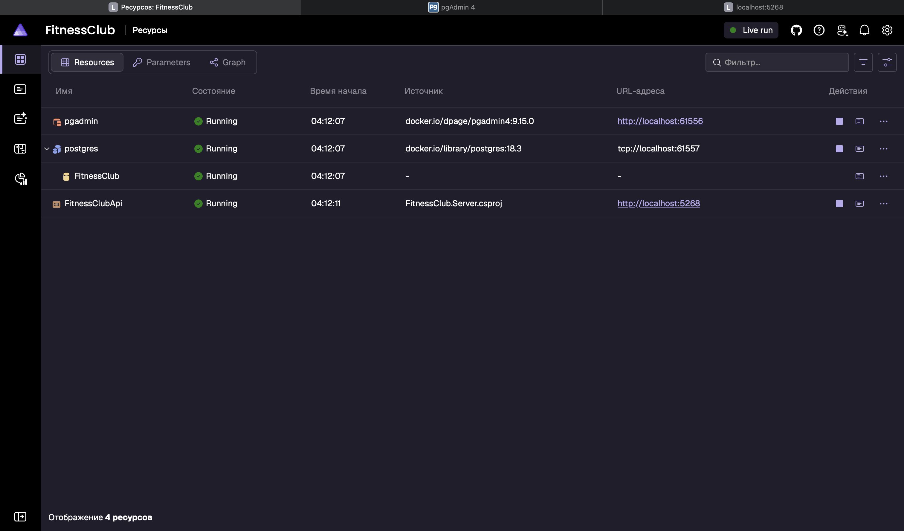
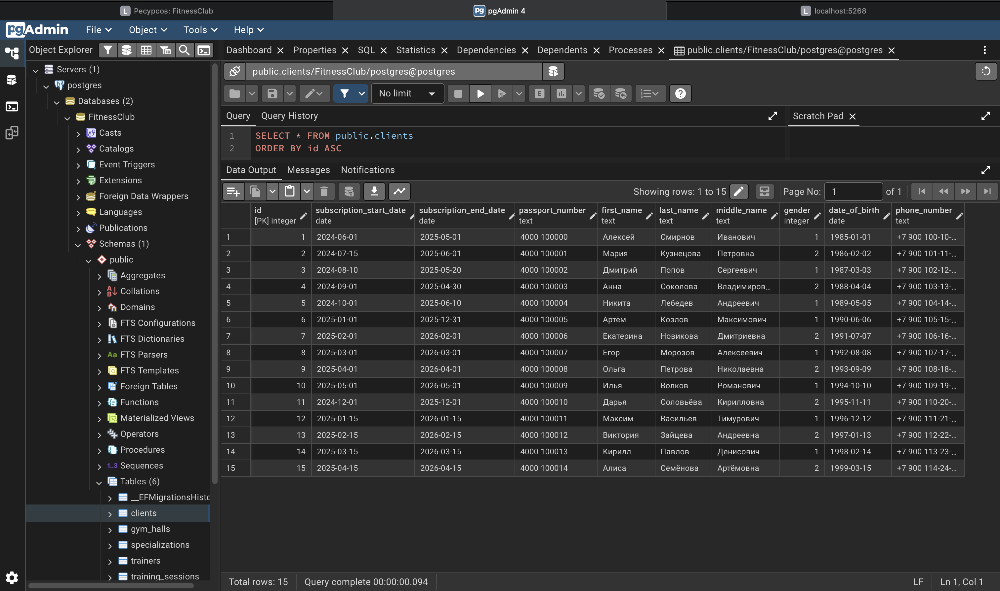

# Разработка корпоративных приложений — лабораторная работа №3

## Тема: Реализация объектно-реляционной модели. Подключение к базе данных и настройка оркестрации

В рамках третьей лабораторной работы выполнено переосмысление архитектуры приложения с переходом от хранения данных в памяти (In-Memory) к полноценной базе данных PostgreSQL с использованием Entity Framework Core. Реализована оркестрация проектов с помощью .NET Aspire для автоматического развёртывания сервера и базы данных.

**Вариант:** 14

---


### Ключевые изменения по сравнению с Lab 2:

1. **Замена In-Memory хранилища на EF Core**  
   Все репозитории переписаны с работы со списками в памяти на работу с `DbContext` и `DbSet<T>`.

2. **Миграции базы данных**  
   Создана начальная миграция `InitialCreate`, которая генерирует все таблицы и заполняет их тестовыми данными через `HasData()`.

3. **Оркестрация через .NET Aspire**  
   Проект `FitnessClub.AppHost` управляет запуском PostgreSQL в Docker-контейнере и веб-приложения, автоматически настраивая строки подключения.

4. **ServiceDefaults**  
   Общий проект `FitnessClub.ServiceDefaults` содержит стандартные настройки для Aspire: OpenTelemetry, health checks, service discovery.

---

## Технологии

| Технология                                | Назначение                       |
|-------------------------------------------|----------------------------------|
| **Entity Framework Core**                 | ORM для работы с БД              |
| **Npgsql.EntityFrameworkCore.PostgreSQL** | Провайдер PostgreSQL для EF Core |
| **.NET Aspire**                           | Оркестрация и наблюдаемость      |
| **PostgreSQL**                            | Реляционная база данных          |
| **Docker**                                | Контейнеризация БД               |

---

## База данных и миграции

### Сущности базы данных

База данных содержит 5 основных таблиц:

1. **Specializations** — справочник специализаций тренеров
2. **GymHalls** — спортивные залы
3. **Clients** — клиенты фитнес-клуба
4. **Trainers** — тренеры (связь со Specializations через FK)
5. **TrainingSessions** — записи на тренировки (связи с Clients, Trainers, GymHalls)

### Начальное заполнение данными

Миграция `InitialCreate` автоматически создаёт и заполняет базу тестовыми данными:

- **10 специализаций** (Силовой тренинг, Кроссфит, Пилатес, Йога, Кардио, и т.д.)
- **10 залов** (разной вместимости от 10 до 50 человек)
- **15 клиентов** (5 с просроченными абонементами, 10 с действующими)
- **10 тренеров** (7 со стажем ≥5 лет, 3 < 5 лет)
- **22 тренировочные сессии** (распределены по залам и тренерам)

#### Создание миграции

```bash
dotnet ef migrations add MigrationName --project FitnessClub.Infrastructure.EfCore --startup-project FitnessClub.Server
```

---

### Aspire Dashboard

После запуска приложения открывается дашборд, где можно:

- Просматривать статус всех ресурсов (Running, Starting, Failed)
- Анализировать логи каждого сервиса
- Отслеживать метрики производительности
- Переходить к PgAdmin для работы с БД


---

## Запуск приложения

### Требования

- **.NET 10 SDK**
- **Docker Desktop** (для запуска PostgreSQL)
- **macOS / Linux / Windows**

### Пошаговый запуск

1. **Перейдите в корневую директорию проекта:**
   ```bash
   cd ~/RiderProjects/FitnessClub
   ```

2. **Запустите проект AppHost:**
   ```bash
   dotnet run --project FitnessClub.AppHost
   ```
3. **Дождитесь запуска всех ресурсов:**

5. **Просмотр базы данных:**
    - В Aspire Dashboard кликните на ресурс **pgadmin**
    - Раскройте: `Servers → postgres → Databases → FitnessClub → Tables`


---